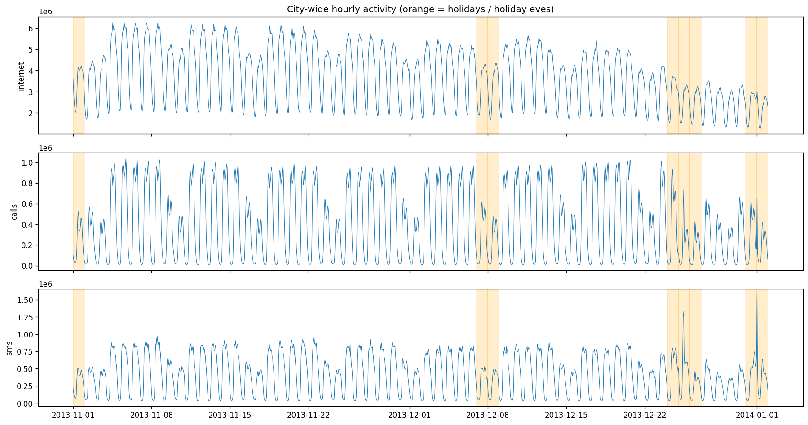
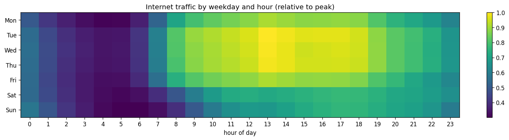
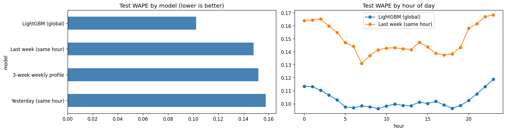
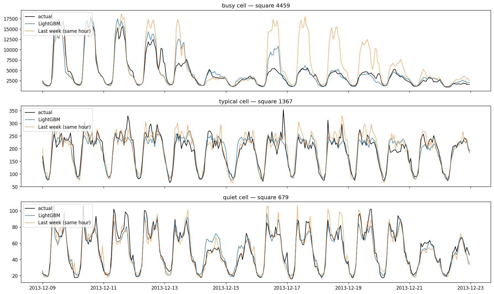
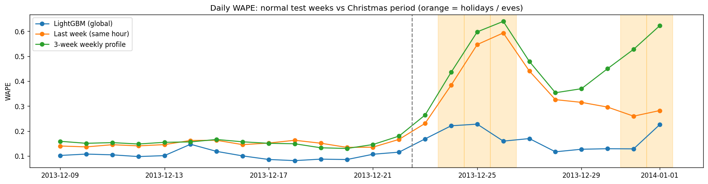

# 📡 Mobile Network Traffic Forecasting — Milan

Day-ahead, hourly forecasting of internet traffic for **2,000 cells of a real mobile network** (Telecom Italia, Milan), using a single **global LightGBM model**.

| | WAPE ↓ (test, 9–22 Dec) | WAPE ↓ (Christmas, 23 Dec – 1 Jan) |
|---|---|---|
| **LightGBM (global)** | **0.102** | **0.167** |
| Best baseline (same hour last week) | 0.148 | 0.367 |

➡️ **31% lower error** than the best baseline on normal days, and **robust over the holidays**, where calendar-based baselines more than double their error.

---

## Why this matters

Mobile operators need to know *tomorrow's* load on every cell:
- **Capacity planning:** anticipate congestion before it happens.
- **Energy saving:** switch lightly loaded cells / carriers to sleep mode at night without hurting service.
- **Anomaly detection:** large gaps between forecast and actual traffic flag outages or unusual events.

## Data

**Telecom Italia Big Data Challenge — Milan** (1 Nov 2013 → 1 Jan 2014)
- Milan is divided into a **100 × 100 grid** of ~235 m squares.
- Activity (SMS, calls, internet) is recorded every **10 minutes** per square and per country code; values are anonymised and unitless.
- Aggregated here to an hourly matrix of **1,488 hours × 10,000 squares** (no missing intervals after aggregation).

Source: Barlacchi et al., *"A multi-source dataset of urban life in the city of Milan and the Province of Trentino"*, Scientific Data (2015) — [Harvard Dataverse, doi:10.7910/DVN/EGZHFV](https://doi.org/10.7910/DVN/EGZHFV). Data used "from BigDataChallenge contest", licensed under ODbL. Downloaded via the Kaggle mirror [`freckled/telecom`](https://www.kaggle.com/datasets/freckled/telecom).




## Approach

**Task:** at midnight, forecast all 24 hours of the next day for every cell, so every feature uses data that is at least 24 hours old.

**Time split (no leakage):**

| Period | Dates | Used for |
|---|---|---|
| Warm-up | 1–7 Nov | lag features only |
| Train | 8–24 Nov | fitting |
| Validation | 25 Nov – 1 Dec | early stopping |
| Refit | 8 Nov – 8 Dec | final model |
| **Test** | **9–22 Dec** | final score (used once) |
| Stress test | 23 Dec – 1 Jan | holiday behaviour |

**Baselines:** same hour yesterday · same hour last week · average of the same hour over the last 3 weeks.

**Model:** one **global LightGBM** model for 2,000 randomly sampled active cells.
- Each cell is scaled by its mean traffic over the training period, so busy and quiet cells share patterns.
- Training is weighted by cell size, so the loss matches the evaluation metric.
- **Features:** traffic at the same hour 1, 2, 3 days and 1, 2, 3 weeks ago; recent daily and weekly averages; hour, weekday and holiday flags; the cell's size and grid position.

**Metric — WAPE** = Σ|actual − forecast| / Σ actual (0.10 = off by 10% of total traffic).

## Results

| Model | WAPE | Median cell WAPE | WAPE of total traffic |
|---|---|---|---|
| **LightGBM (global)** | **0.102** | **0.102** | **0.041** |
| Last week (same hour) | 0.148 | 0.135 | 0.056 |
| 3-week weekly profile | 0.152 | 0.117 | 0.063 |
| Yesterday (same hour) | 0.158 | 0.151 | 0.075 |



- LightGBM beats every baseline **at every hour of the day**. Errors are highest at night, when traffic is low and small absolute errors become large percentages.
- For the **total traffic** of all sampled cells, the error drops to **4.1%**, because errors in individual cells partly cancel out.
- The 3-week profile is the weakest baseline overall but the best on the *median* cell: it suits typical cells but lags behind changing traffic in busy areas before Christmas. The model handles this by also using recent days.



### Christmas stress test

The final model saw only two holidays during training (7–8 Dec). Calendar-based baselines assume "this week looks like last week" and collapse over the holidays, reaching ~60% error on Christmas Day. LightGBM adapts through recent lags and holiday flags.

| Model | Test 9–22 Dec | Holidays 23 Dec – 1 Jan |
|---|---|---|
| **LightGBM (global)** | **0.103** | **0.167** |
| Last week (same hour) | 0.149 | 0.367 |
| 3-week weekly profile | 0.152 | 0.474 |



## Limitations

- One test window (2 weeks) from a single city and season.
- 2,000 of the 10,000 cells were modelled (random sample of active cells).
- Holiday behaviour is learned from very few examples; errors still rise on Christmas Day and New Year's Day (~0.23).
- Saturday 14 Dec shows an unexplained error bump (≈0.15), possibly a shopping weekend or local event.

## Next steps

- Features from neighbouring cells (traffic moves across the city during the day).
- Probabilistic forecasts (quantile regression), since capacity planning cares about peaks.
- Comparison with deep learning models (LSTM / Temporal Fusion Transformer).
- Rolling-origin evaluation over several test windows.

## How to run

1. Open `network_traffic_forecasting.ipynb` in Google Colab (a CPU runtime is enough).
2. Run all cells. The data (~5 GB) is downloaded automatically from Kaggle with `kagglehub` and aggregated to `milan_hourly.npz`.
3. Figures and result tables are saved to `/content/milan_out/`.

## Repository structure

```
├── network_traffic_forecasting.ipynb   # full pipeline: data → EDA → baselines → LightGBM → evaluation
├── figures/                            # charts used in this README
├── test_results.csv                    # test metrics per model
├── holiday_stress_test.csv             # normal weeks vs holidays
└── README.md
```

**Tech:** Python · pandas · NumPy · LightGBM · Matplotlib · Google Colab

---

**Author:** Hussein Khreiss: IT & telecom professional moving into AI / data science. [LinkedIn](https://www.linkedin.com/in/hussein-khreiss-5a9758143/) · [GitHub](https://github.com/husseinkhreiss10-creator)
